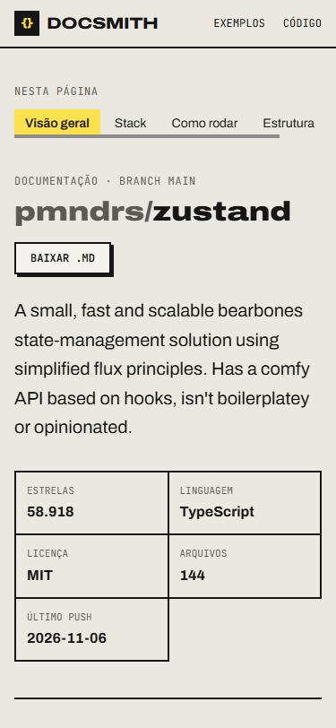

# docsmith

**PT** · Cole a URL de um repositório público do GitHub e receba um site de documentação: visão geral, stack, estrutura de pastas, como rodar e API (exports, rotas e funções públicas). Cada repo ganha uma URL compartilhável, `/r/dono/repo`.
**EN** · Paste a public GitHub repo URL and get a documentation site: overview, stack, folder structure, how to run, and API (exports, routes, public functions). Every repo gets a shareable URL, `/r/owner/repo`.

🔗 **Ao vivo / Live:** https://docsmith-vhcode.vercel.app · exemplo: https://docsmith-vhcode.vercel.app/r/pmndrs/zustand



## Português

### Como funciona
1. **Lê** metadados, árvore completa, README e `package.json` pela API pública do GitHub
2. **Escolhe** até 24 arquivos com mais chance de definir a API (entradas, `route.ts`, `src/`, `lib/`), ignorando testes, builds e exemplos
3. **Extrai** exports de TS/JS, handlers de rota do Next.js, rotas Express/FastAPI, `def`/`class` públicas em Python e funções exportadas em Go
4. **Monta** a página com índice fixo (scrollspy), árvore navegável, comandos copiáveis e exportação em Markdown

### API pública
```
GET /api/v1/repos/{owner}/{repo}/docs
200 { "data": Docs }
400 invalid_repo · 404 not_found · 413 too_large · 429 rate_limit_exceeded (Retry-After) · 502 upstream
```
Respostas com `Cache-Control: s-maxage=3600, stale-while-revalidate`.

### Segurança e robustez
- `owner` e `repo` passam por validação de charset antes de qualquer requisição (sem path traversal ou SSRF)
- Limite de tamanho por arquivo e por repositório, máximo de arquivos analisados
- Rate limit por IP na rota da API
- Resultado cacheado por 1 hora com `"use cache"` + `cacheLife("hours")` do Next 16
- Cabeçalhos CSP, HSTS, X-Frame-Options, nosniff

### Variável opcional
`GITHUB_TOKEN` (token sem nenhuma permissão, só leitura pública) aumenta o limite da API do GitHub de 60 para 5.000 consultas por hora.

### Stack
Next.js 16 (Cache Components, Partial Prerender) · React 19 · TypeScript · Tailwind CSS 4 · Motion · Vitest

### Como rodar
```bash
npm install
npm run dev
npm test
```

## English

Reads a public repo through the GitHub API, ranks the files most likely to define its public surface, statically extracts exports/routes/functions (TS/JS, Python, Go), and renders a docs page with a sticky TOC, collapsible file tree, copyable commands and Markdown export. Public JSON API at `/api/v1/repos/{owner}/{repo}/docs`. Optional `GITHUB_TOKEN` raises the GitHub rate limit.
